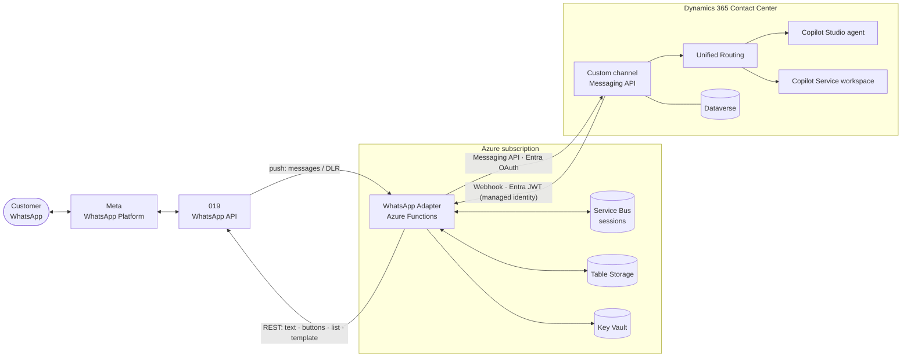

# Dynamics 365 Contact Center – WhatsApp Custom Channel via 019

A production-grade **custom messaging channel** that connects **WhatsApp Business** (through the Israeli provider **019**) to **Microsoft Dynamics 365 Contact Center**. It uses the Contact Center **Messaging API**, **Copilot Studio** agents and **Azure** serverless components.

Customers chat on WhatsApp. Conversations are routed by **Unified Routing**, handled first by a **Copilot Studio** agent with native WhatsApp **reply buttons and lists**, and escalated to representatives in the **Copilot Service workspace**. Proactive **WhatsApp templates** are queued as rows in a Dataverse **elastic table** through a **Custom API**, so Power Automate, Copilot Studio, connectors and any system can send them and track their full lifecycle.



## Highlights

| Capability | Description |
|---|---|
| **Native channel experience** | Messaging workstream, unified routing, queues, capacity, transcripts, automated messages, surveys and data masking, all standard Contact Center features |
| **Copilot Studio first** | The agent greets, answers and escalates. Escalation keeps the full context |
| **Interactive WhatsApp UI** | Reply buttons (up to 3) and lists (up to 10) rendered natively from Copilot Studio through a reusable topic, *WA · Ask with options* |
| **Selection round-trip** | Every tap returns to the agent as **text** (for matching) with the stable option ID in `value`. A full JSON payload (`wa_LastInteraction`) is available as an opt-in |
| **Templates and outbound** | Template catalog synced into Dataverse. Every proactive message is a *WhatsApp Message* row (elastic, automatic retention) created by the `SendWhatsAppMessage` **Custom API**: send now or schedule, cancel, idempotency, full status lifecycle |
| **Exact button correlation** | A tap on a template quick-reply is matched to the exact message sent. The routed conversation receives the template, button, campaign and related record as context variables |
| **Secret-free outbound queue** | A Dataverse plug-in enqueues to Service Bus with a **Power Platform managed identity** (federated credential). No SAS keys |
| **Delivery visibility** | Sent, delivered, read and failure states. Failures appear to the representative in the conversation |
| **Zero-secret D365 webhook** | Dynamics 365 calls the adapter with an Entra token issued through a **Power Platform managed identity** and **federated credential** |
| **Certificate-based auth** | The adapter authenticates to Dynamics 365 with an Entra app certificate stored in Key Vault |
| **Private data plane** | Key Vault and Storage are reachable only through **private endpoints**. The Function App uses **VNet integration** |
| **Ordered and idempotent** | Service Bus **sessions** give per-conversation FIFO. Every ingress is de-duplicated |

## Repository layout

```text
.
├── src/adapter/          Azure Functions (Node.js / TypeScript) – the WhatsApp Adapter
│   ├── src/functions/    HTTP endpoints, Service Bus processors, timer
│   ├── src/lib/          019 client, Messaging API client, mapping, templates, outbound, state, auth
│   └── test/             Unit tests (node:test)
├── src/plugins/          Dataverse plug-in (.NET Framework 4.6.2): Send/Cancel Custom APIs, enqueue step + tests
├── connector/            OpenAPI (Swagger 2.0) definition for an optional Power Platform custom connector
├── infra/                Bicep – Azure landing zone for the adapter
├── scripts/              Dataverse / Contact Center provisioning (idempotent PowerShell)
├── copilot-studio/       Copilot Studio topics (YAML)
└── docs/                 Architecture, data model, security, deployment, operations
```

## Documentation

**Start here:** [Solution architecture](docs/architecture.md) → [Deployment guide](docs/deployment.md) → [Outbound messaging](docs/outbound-messaging.md).

### Understand the solution

| Document | Content |
|---|---|
| [Solution architecture](docs/architecture.md) | Solution concept, components, end-to-end sequences |
| [Data model (ERD)](docs/data-model.md) | Dataverse tables, Contact Center entities, adapter state |
| [Azure components](docs/azure-components.md) | Resource inventory, networking, role assignments, sizing |
| [Security](docs/security.md) | Identities, authentication flows, network, secrets, data protection, threat model |

### Deploy

| Document | Content |
|---|---|
| [Deployment guide](docs/deployment.md) | Step-by-step provisioning of Azure, Entra ID, Dataverse, plug-in and Copilot Studio |
| [Outbound messaging – deployment](docs/outbound-messaging.md#8-deployment) | Elastic table, plug-in signing, Custom APIs, plug-in managed identity |

### Build on it (makers and developers)

| Document | Content |
|---|---|
| [Outbound messaging](docs/outbound-messaging.md) | **Send WhatsApp templates**: lifecycle, WhatsApp Message table, Custom API reference, Power Automate, Copilot Studio, custom connector, button correlation |
| [Templates and outbound](docs/templates-and-outbound.md) | Template catalog sync, REST API, `/tpl` command, delivery tracking, consent |
| [Copilot Studio integration](docs/copilot-studio.md) | Option block contract, *WA · Ask with options*, selection payload, global variables |
| [Maker guide: interactive messages](docs/interactive-messages-maker-guide.md) | No-code recipes for quick replies, buttons, lists and link buttons |
| [Conversation context and customer identity](docs/conversation-context.md) | `msdyn_customengagementctx`, workstream context variables, naming contract, WhatsApp usernames |
| [Attachments](docs/attachments.md) | Images and files in both directions, channel settings, bot vs representative, signed links, 019 limits |
| [Custom connector definition](connector/whatsapp-messaging.swagger.json) | OpenAPI file for the optional custom connector |

### Operate

| Document | Content |
|---|---|
| [Operations](docs/operations.md) | Telemetry events, alerts, runbooks, health endpoints |
| [Outbound troubleshooting](docs/outbound-messaging.md#10-troubleshooting) | Symptoms, causes and fixes for the outbound pipeline |
## Quick start

```powershell
# 1. Azure infrastructure
az group create -n rg-wa019-dev -l westeurope
az deployment group create -g rg-wa019-dev -f infra/main.bicep -p infra/main.parameters.json

# 2. Adapter: download adapter-<version>.zip from the latest GitHub Release, then
az functionapp deployment source config-zip -g rg-wa019-dev -n <function-app-name> --src adapter-<version>.zip
#    (or build from source: cd src/adapter; npm ci; npm test; func azure functionapp publish <function-app-name> --typescript)

# 3. Dynamics 365 Contact Center + Copilot Studio
cd scripts
copy env.example.json env.json     # fill in your environment values
./01-solution-and-tables.ps1
./02-channel.ps1
./03-copilot-studio.ps1
./05-outbound-messages.ps1                      # WhatsApp Message elastic table
./06-plugin-and-custom-api.ps1 -DevCertificate  # plug-in + Custom APIs (production: -CertificatePath)
./04-security-role.ps1
```

See the [deployment guide](docs/deployment.md) for prerequisites, secrets and the 019 webhook configuration.

## Technology

- **Dynamics 365 Contact Center:** Messaging API custom channel, Unified Routing, Copilot Service workspace
- **Microsoft Copilot Studio:** topics, global variables, Omnichannel context
- **Microsoft Dataverse:** template catalog, WhatsApp Message elastic table, Custom APIs, plug-in with managed identity, environment variables, security roles
- **Azure:** Functions (Flex Consumption, Node.js), Service Bus, Storage (Tables/Blobs), Key Vault, Application Insights, Virtual Network, Private Endpoints
- **Microsoft Entra ID:** app registration (certificate), federated identity credential, Power Platform managed identity
- **019:** WhatsApp Business API (messages, buttons, lists, templates, typing, delivery reports)

## Contributing

See [CONTRIBUTING.md](CONTRIBUTING.md). Report security issues as described in [SECURITY.md](SECURITY.md).

## License

[MIT](LICENSE)

## Trademarks

Microsoft, Dynamics 365, Copilot Studio, Dataverse, Azure and Microsoft Entra are trademarks of the Microsoft group of companies. WhatsApp is a trademark of Meta Platforms, Inc. 019 is a trademark of its respective owner. This project is not affiliated with, endorsed by or sponsored by Meta or 019.
