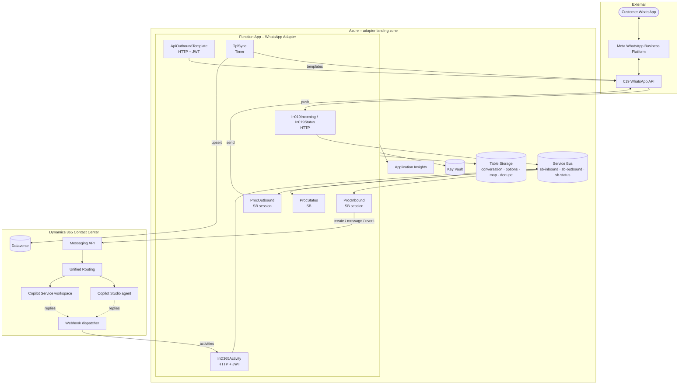
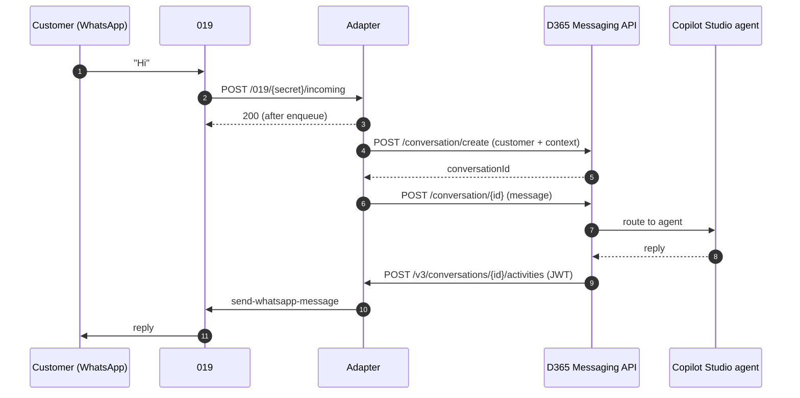
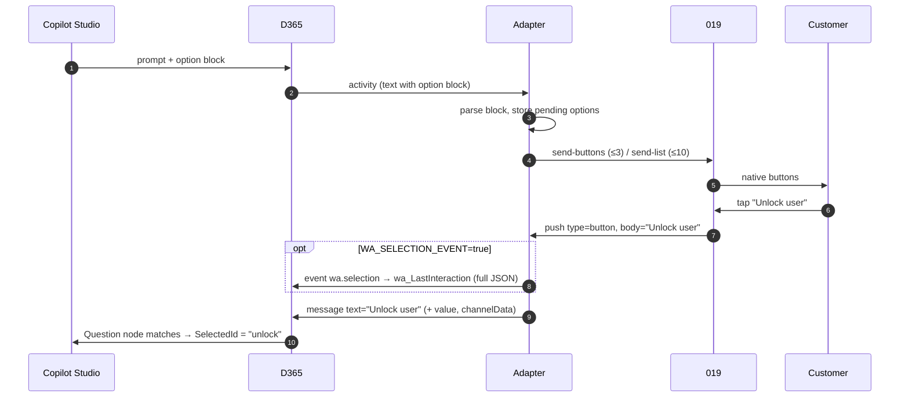
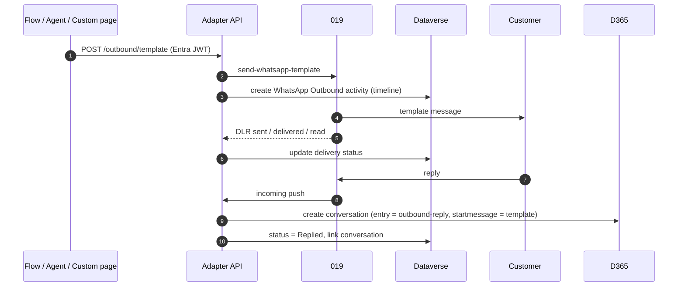

# Solution architecture

## 1. Solution concept

WhatsApp is delivered to Dynamics 365 Contact Center as a **first-class custom messaging channel**, built on the **Messaging API**.

A single serverless component, the **WhatsApp Adapter**, translates between two worlds:

| Side | Protocol | Direction |
|---|---|---|
| **019 WhatsApp API** | REST (Bearer token) + push webhooks (messages, delivery reports, system events) | Both ways |
| **Dynamics 365 Contact Center Messaging API** | REST (Entra OAuth) + webhook (Entra JWT) using the Bot Framework Activity schema | Both ways |

Everything else is **standard product configuration**: workstream, routing, queues, Copilot Studio agent, automated messages, masking and surveys. A small Dataverse solution adds the template catalog and the outbound activity.

### Design principles

1. **Native first.** Use Contact Center features for routing, the agent, the workspace and the transcript. The adapter only translates.
2. **Documented contracts only.** The adapter depends solely on the documented fields of the Messaging API and the 019 API.
3. **Author once in Copilot Studio.** Buttons and lists are authored with standard topics. Channel rendering is the adapter's job.
4. **Asynchronous by default.** Webhooks acknowledge immediately. Processing runs through Service Bus with per-conversation ordering.
5. **No shared secrets toward Microsoft.** Certificates and managed identity are used end to end.

## 2. Logical architecture

## 3. Components

| Component | Responsibility |
|---|---|
| `In019Incoming` | Receives 019 message pushes. Validates the route secret and line, de-duplicates, and enqueues to `sb-inbound` (session = line + WhatsApp user) |
| `In019Status` | Receives delivery reports (`hook: update`) and system events (`hook: system`), and enqueues to `sb-status` |
| `InD365Activity` | Webhook endpoint for Dynamics 365 (`/v3/conversations/{id}/activities`). Validates the Entra JWT and enqueues to `sb-outbound` (session = conversation) |
| `ProcInbound` | Creates or continues conversations through the Messaging API, maps message types, resolves button and list selections, handles opt-out |
| `ProcOutbound` | Renders agent and representative activities into WhatsApp text, buttons or lists. Handles typing, close events and the `/tpl` command |
| `ProcStatus` | Updates delivery status, sends read receipts, posts delivery notices to representatives, tracks template status |
| `ApiOutboundTemplate` | Entra-protected API for sending templates (flows, custom connector, custom page) |
| `TplSync` | Synchronizes 019 templates into the Dataverse template catalog every 15 minutes |

## 4. Key sequences

### 4.1 Inbound conversation with the agent

### 4.2 Interactive buttons and selection round-trip

### 4.3 Outbound template and reply

## 5. Message mapping

| WhatsApp (019) | Dynamics 365 |
|---|---|
| `text` | `message.text` |
| `button`, `list` | `message.text` = original label + `value` / `channelData.wa.selection`. Optional selection event (`wa_LastInteraction`) |
| `location` | Text with a map link |
| `contacts` | Text with the contact name and number |
| `reaction` | Ignored |
| Media (`image`, `video`, `audio`, `ptt`, `document`) | Customer receives a "text only" response. Representative is notified |

| Dynamics 365 activity | WhatsApp (019) |
|---|---|
| Message (plain) | `send-whatsapp-message` (Markdown → WhatsApp formatting, 4,096-character split) |
| Message with option block, suggested actions, or Hero / Adaptive Card | `send-buttons` / `send-list` / numbered text |
| `typing` | `typing` |
| Close events | Conversation state closed |
| Representative `/tpl <name> v1\|v2` | `send-whatsapp-template` |

## 6. Conversation state

- **Per-conversation ordering:** Service Bus sessions (`{line}:{waUser}` inbound, `conversationId` outbound).
- **Idempotency:** a `Dedupe` table keyed by the 019 message id and the D365 activity id. `customerid` is supplied on `conversation/create`, so an active conversation is reused.
- **Conversation lifecycle:** close events from Dynamics 365 mark the conversation closed. The next customer message opens a new routed conversation.
- **24-hour window:** free-form messages are sent inside the WhatsApp customer-service window. Outside it, representatives send an approved template.
