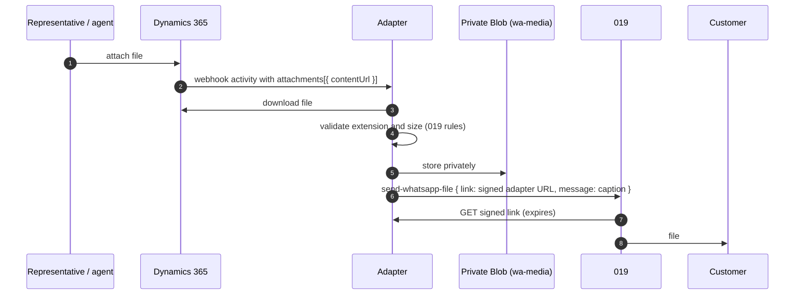

# Attachments (images and files)

This document describes how the channel exchanges images and files between WhatsApp customers and Dynamics 365 Contact Center, how it respects the channel's administrator settings, and how it treats the Copilot Studio agent differently from human representatives.

## 1. Summary

| Direction | Sender | Behavior (attachments enabled) |
|---|---|---|
| Customer → Contact Center | Customer, while a **representative** handles the conversation | File is downloaded from 019 and posted to the conversation as an attachment |
| Customer → Contact Center | Customer, while the **agent bot** handles the conversation | Customer is asked to continue with a representative (configurable) |
| Contact Center → customer | **Representative** | File is validated, stored privately, and sent through 019 |
| Contact Center → customer | **Agent bot** | Same as representative. The representative setting applies to people only |

## 2. Administrator control (out of the box)

The adapter follows the **File attachments** settings of the custom messaging channel in Contact Center admin center (*Channels → WhatsApp → User features*). No adapter change is needed to turn attachments on or off.

| Channel setting | Column (`msdyn_occustommessagingchannel`) | Adapter behavior when **off** |
|---|---|---|
| Customers can send file attachments | `msdyn_enablefileattachmentsforcustomers` | Customer receives "text only" (`MEDIA_NOT_SUPPORTED_TEXT`). Representative receives a notice |
| Representatives can send file attachments | `msdyn_enablefileattachmentsforagents` | File isn't sent. Representative receives a notice |

- The adapter reads the settings with its Dataverse application user and caches them for 5 minutes.
- If the settings can't be read, attachments are treated as **disabled** (fail closed).
- Organization-wide limits in Contact Center (maximum file size, blocked extensions) still apply to what representatives can attach.

## 3. Bot or representative

The adapter tracks who is answering the customer in each conversation:

| Signal from Dynamics 365 | Participant |
|---|---|
| New conversation | `bot` |
| Message with `from.role = "bot"` | `bot` |
| `AgentJoined`, `AgentAccepted`, `AgentAssigned`, `TransferAgentAcceptSession` event | `agent` |
| Message from a representative | `agent` |

Customer files go to representatives only. Copilot Studio agents don't process customer files by default; set `WA_MEDIA_TO_BOT=true` to forward them to the agent bot as well.

## 4. Customer → Contact Center

```mermaid
sequenceDiagram
    autonumber
    participant C as Customer
    participant O as 019
    participant A as Adapter
    participant D as Dynamics 365
    C->>O: image / document / audio / video
    O->>A: incoming push (media link in body)
    A->>A: check channel setting + participant
    A->>O: download file (size limit)
    A->>D: message with attachments[{ contentType, name, contentUrl: data:…;base64 }]
    D-->>D: representative sees the file in the conversation
```

- The 019 media link is valid for a limited time, so the adapter downloads the file immediately.
- The file is posted to the Messaging API as **embedded base64**, so nothing is stored in Azure for this direction.
- `WA_MEDIA_INBOUND_MAX_MB` (default 5, matching the Dynamics 365 default) limits the size. Larger files get a polite reply and a representative notice.
- A caption, if present, is sent as the message text.

## 5. Contact Center → customer



### 5.1 019 file rules

| Category | Extensions | Maximum size |
|---|---|---|
| Image | jpg, jpeg, png, gif | 5 MB |
| Video | mp4, avi, 3gpp | 16 MB |
| Audio | mp3, ogg, amr, aac | 16 MB |
| Document | pdf, doc, docx, xls, xlsx, ppt, ppts, zip, txt, rar | 100 MB |

Unsupported or oversized files aren't sent. The representative receives a notice with the reason.

### 5.2 Private storage and signed links

- Files are stored in the private `wa-media` container. Storage public access stays disabled.
- 019 receives a link to the adapter's `GET /api/media/{path}?exp=…&sig=…` endpoint. The link is signed with HMAC-SHA256 and expires after `WA_MEDIA_LINK_MINUTES` (default 60).
- A lifecycle rule deletes files after **1 day**.

### 5.3 Destination (out-of-the-box default)

| `WA_FILE_DESTINATION` | Behavior |
|---|---|
| `phone-first` **(default)** | Send to the customer's phone number when known, otherwise to the WhatsApp user ID |
| `id` | Always send to the WhatsApp user ID |

The default exists because 019's file endpoint currently rejects the WhatsApp user ID (`IL.…`) with `timingRuleError`, even inside the 24-hour window, while text, buttons and lists accept it. For customers who hide their phone number, the representative receives a specific notice instead of a misleading "24-hour window" message.

## 6. Settings

| App setting | Default | Purpose |
|---|---|---|
| `WA_MEDIA_INBOUND_MAX_MB` | `5` | Maximum size of customer files |
| `WA_MEDIA_TO_BOT` | `false` | Also forward customer files to the agent bot |
| `WA_MEDIA_BOT_TEXT` | Hebrew prompt | Reply when a customer sends a file to the bot |
| `WA_FILE_DESTINATION` | `phone-first` | Destination for outgoing files |
| `WA_MEDIA_CONTAINER` | `wa-media` | Blob container |
| `WA_MEDIA_LINK_MINUTES` | `60` | Signed link lifetime |
| `ADAPTER_PUBLIC_BASE_URL` | Function App host | Base URL for signed links |

## 7. Security

| Control | Implementation |
|---|---|
| Least privilege | The adapter role gets **read** on `msdyn_occustommessagingchannel` only |
| No public storage | Blob public access disabled. Files are served only through signed, expiring adapter links |
| Short retention | 1-day lifecycle on `wa-media`. Inbound files aren't stored |
| Content type safety | Allow-list of extensions, size limits, `X-Content-Type-Options: nosniff` |
| Logging | Logs include type and size only, never file content or links |
