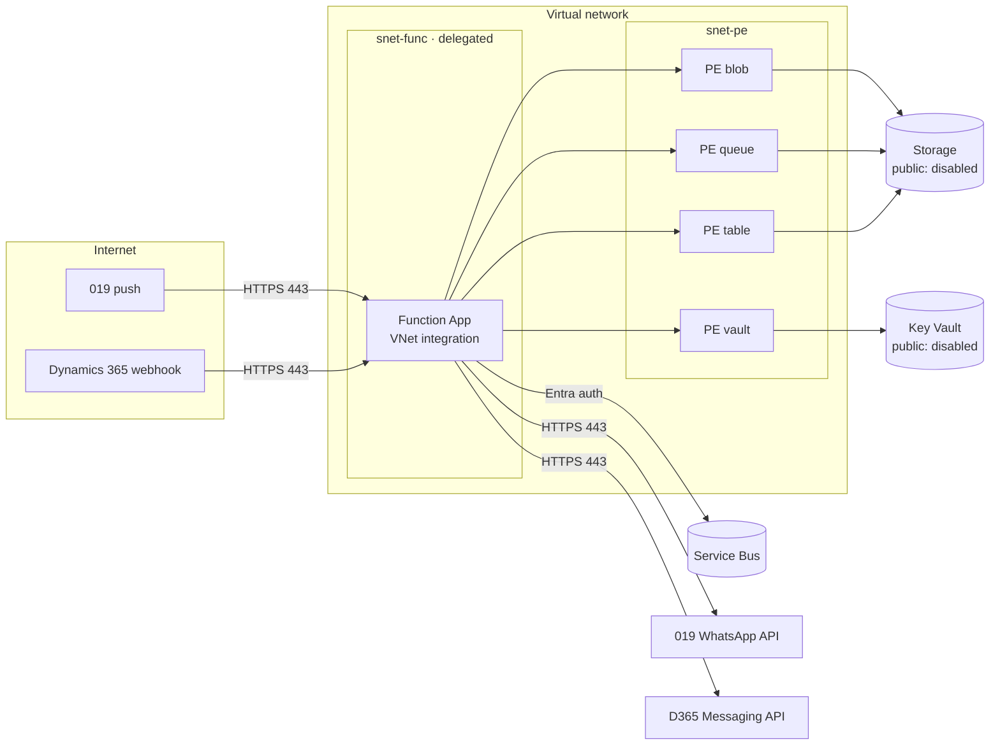

# Azure components

All resources are defined in [`infra/main.bicep`](../infra/main.bicep) and named `<prefix>-<env>`.

## 1. Resource inventory

| Resource | SKU / configuration | Purpose |
|---|---|---|
| **Function App** | Flex Consumption (FC1), Linux, Node.js, system-assigned managed identity, HTTPS only, TLS 1.2, VNet integrated | WhatsApp Adapter runtime |
| **Service Bus namespace** | Standard, local (SAS) auth disabled, TLS 1.2 | Durable decoupling of webhooks and processing |
| ├ `sb-inbound` | Sessions enabled, max delivery 5, TTL 1 day, DLQ on expiry | 019 → D365, FIFO per WhatsApp user |
| ├ `sb-outbound` | Sessions enabled, max delivery 5, TTL 1 day | D365 → 019, FIFO per conversation |
| ├ `sb-status` | Max delivery 5, TTL 1 day | Delivery reports and system events |
| └ `sb-template` | No sessions, max delivery 5, TTL 14 days, scheduled messages | Outbound template requests enqueued by the Dataverse plug-in (row ID only) |
| **Storage account** | StorageV2 LRS, shared key disabled, public blob access disabled, public network disabled, OAuth by default | Function deployment package, adapter state tables |
| **Key Vault** | Standard, RBAC authorization, soft delete, public network disabled | 019 API token, webhook route secret, Entra app certificate |
| **Virtual network** | `snet-func` (/26, delegated to `Microsoft.App/environments`), `snet-pe` (/27) | Function egress, private endpoints |
| **Private endpoints + DNS** | Blob, Queue, Table, Key Vault (private DNS zones linked to the VNet) | Private data plane |
| **Log Analytics + Application Insights** | Workspace-based, 30-day retention | Telemetry, correlation and alerting |

## 2. Network topology

| Flow | Direction | Protocol | Authentication |
|---|---|---|---|
| 019 → Adapter | Inbound | HTTPS 443 | Route secret + line allow-list |
| D365 → Adapter | Inbound | HTTPS 443 | Entra JWT (Power Platform managed identity + FIC) |
| Flows / connector → Adapter | Inbound | HTTPS 443 | Entra JWT |
| Adapter → 019 | Outbound | HTTPS 443, TLS 1.2+ | Bearer token (Key Vault) |
| Adapter → Messaging API / Dataverse | Outbound | HTTPS 443 | Entra client credentials (certificate) |
| Adapter → Key Vault / Storage | Private | Private endpoint | Managed identity (RBAC) |
| Adapter → Service Bus | Outbound | AMQP / HTTPS | Managed identity (RBAC) |
| Dataverse plug-in → Service Bus `sb-template` | Inbound to Service Bus | HTTPS 443 (REST) | Power Platform managed identity (federated credential), *Azure Service Bus Data Sender* on the queue |

## 3. Role assignments (managed identity)

| Scope | Role |
|---|---|
| Storage account | Storage Blob Data Owner, Storage Table Data Contributor, Storage Queue Data Contributor |
| Service Bus namespace | Azure Service Bus Data Owner |
| Key Vault | Key Vault Secrets User |
| Service Bus queue `sb-template` | Azure Service Bus Data Sender – **plug-in identity** (Entra app, not the Function App) |
| Application Insights | Monitoring Metrics Publisher |

## 4. Scaling

| Setting | Value | Note |
|---|---|---|
| Maximum instances | 40 | Flex Consumption |
| Instance memory | 2,048 MB | — |
| Service Bus concurrent sessions | 16 per instance | `host.json` |
| WhatsApp send rate | 80 msg/s per number, 10 msg/min per recipient | 019 / Meta platform limits, enforced with Service Bus retry |

## 5. Optional hardening add-ons

| Add-on | Benefit |
|---|---|
| Azure Front Door / Application Gateway WAF | OWASP protection, rate limiting, IP filtering in front of the adapter |
| NAT Gateway | Static egress IP for 019 *Authorized IP Address Check* and Entra named locations |
| API Management | Central policy, quotas and catalog for the outbound API |
| Customer-managed keys | CMK for Storage and Service Bus |
| Microsoft Defender for Cloud | Threat protection for App Service, Key Vault and Storage |
| Microsoft Sentinel / SIEM | Export of Application Insights, Entra and Key Vault logs |
