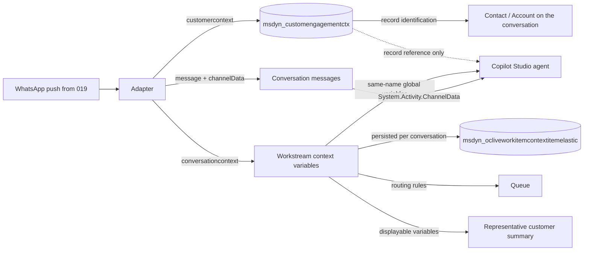

# Conversation context and customer identity

This document explains how the channel hands customer and conversation data to Dynamics 365 Contact Center and to the Copilot Studio agent. It covers the three data paths, the `msdyn_customengagementctx` table, workstream context variables, and the naming contract that ties them together.

## 1. Three data paths

When the first WhatsApp message of a conversation arrives, the adapter calls the Messaging API **create conversation** endpoint. One request carries two different payloads, and every later message can carry a third:

| Path | Sent | Stored in Dynamics 365 | Reaches the agent as | Purpose |
|---|---|---|---|---|
| **`customercontext`** | Once, at conversation creation | `msdyn_customengagementctx` (one row per conversation) | A **record reference** only (ID + display name) | Customer identification and the representative's view of who is writing |
| **`conversationcontext`** | Once, at conversation creation | `msdyn_ocliveworkitemcontextitemelastic` (one row per variable) | **Values** in global variables with the same names | Routing, agent logic, representative's customer summary |
| **`channelData`** | With every message | Message transcript | `System.Activity.ChannelData` | Per-message metadata (019 message ID, message type, selected option) |



## 2. `msdyn_customengagementctx`

### 2.1 What it is

`msdyn_customengagementctx` (**Custom engagement context**) is the Dynamics 365 table that holds the customer details of a conversation on a **custom messaging channel**. Dynamics 365 creates one row per conversation and links it to the conversation (`msdyn_ocliveworkitem`).

The adapter never writes to the table directly. It sends `customercontext` in the create-conversation request, and Dynamics 365 (system user *# Contact Center*) creates and fills the row.

| `customercontext` field (adapter) | Column in `msdyn_customengagementctx` | Value from this channel |
|---|---|---|
| `customerid` | `msdyn_customsenderid` | `<business line>:<WhatsApp user ID>`, for example `9725XXXXXXXX:IL.1234567890` |
| `phonenumber` | `msdyn_customerphonenumber` | Customer phone number in E.164 digits (omitted when the customer hides it) |
| `preferredname` | `msdyn_customername` | WhatsApp profile name |
| (set by Dynamics 365) | `msdyn_customchanneltype` | `MessagingApi` |

### 2.2 Why it matters

| Area | Role of the table |
|---|---|
| **Customer identification** | Record identification rules match the phone number and sender ID to a Contact or Account. The match populates the conversation's **Customer** field and the representative's customer profile. |
| **Representative experience** | The conversation title and customer card show the name and number from this row. |
| **Returning customers** | `msdyn_customsenderid` is a stable key per business line and WhatsApp user, so a returning customer is recognized across conversations. |
| **Reporting and audit** | The row keeps who the customer was for every conversation, even when no Contact was matched. |

### 2.3 What the agent receives

The Copilot Studio agent receives **only a reference** to the row, inside the conversation start context:

```json
"msdyn_msdyn_ocliveworkitem_msdyn_customengagementctx_liveworkitemid": [
  { "RecordId": "<row id>", "PrimaryDisplayValue": "<customer name>" }
]
```

The columns themselves (phone number, sender ID) are **not** passed as values. An agent that needs them must either read the row from Dataverse or, as this channel does, receive the same values through context variables (section 3).

## 3. Workstream context variables

### 3.1 What they are

Context variables are named values defined **on the workstream** (`msdyn_ocliveworkstreamcontextvariable`). They form the **contract** between the channel and Dynamics 365: only variables defined on the workstream are accepted from `conversationcontext`.

### 3.2 Why they matter

| Consumer | How it uses context variables |
|---|---|
| **Copilot Studio agent** | Each variable is delivered to a **global variable with exactly the same name** that has *External sources can set values* enabled. This is the only direct way to hand values to the agent at conversation start. |
| **Unified routing** | Classification and route-to-queue rules can branch on context variables, for example by entry point or business line. |
| **Representative** | Variables marked **displayable** appear in the conversation's customer summary. |
| **Automation and reporting** | Flows and plug-ins can read the conversation context for the same values. |

### 3.3 The naming contract

The **same name** must exist in three places. If any one differs, the value is silently dropped.

| # | Where | Example |
|---|---|---|
| 1 | Workstream context variable (`scripts/02-channel.ps1`) | `wa_CustomerPhone` |
| 2 | Adapter `conversationcontext` (`src/adapter/src/lib/processors.ts`) | `wa_CustomerPhone: { isDisplayable: true, value: "9725…" }` |
| 3 | Copilot Studio global variable, *External sources can set values* | `Global.wa_CustomerPhone` |

Names are case-sensitive. The `wa_` prefix keeps the channel's variables separate from system variables.

### 3.4 Variables sent by this channel

| Name | Shown to representative | Source | Content |
|---|---|---|---|
| `wa_LineNumber` | No | 019 push `to` | WhatsApp business line that received the message |
| `wa_UserId` | No | 019 push `from_id`, otherwise `from` | WhatsApp user ID: the business-scoped user ID (BSUID) when available, otherwise the phone number |
| `wa_CustomerId` | No | Adapter | `<line>:<user ID>`, identical to `customercontext.customerid` and `msdyn_customsenderid` |
| `wa_CustomerPhone` | Yes | 019 push `from` (digits only) | Customer phone number, identical to `msdyn_customerphonenumber`. Omitted when the customer hides the number |
| `wa_ProfileName` | Yes | 019 push `senderName` | WhatsApp profile name, identical to `customercontext.preferredname` |
| `wa_Username` | Yes | 019 push `username` | WhatsApp username, when the customer has one |
| `wa_EntryPoint` | Yes | Adapter | `organic` · `outbound-reply` · `template-button` |
| `wa_ReferralMessageId` | No | 019 push `quoteUnique` | 019 ID of the message the customer replied to or tapped (for example a template button) when starting the conversation |
| `wa_Referral` | No | 019 push `referral` | Click-to-WhatsApp ad referral (JSON), when the conversation starts from an ad |
| `wa_TemplateName` | Yes | Outbound log | Template that started the conversation (outbound replies only) |
| `wa_CampaignId` | No | Outbound log | Campaign correlation (outbound replies only) |
| `wa_RelatedRecordId` | No | Outbound log | Record that triggered the outbound message (outbound replies only) |
| `wa_Is24hWindowOpen` | No | Adapter | Informational |
| `wa_LastInteraction` | No | Selection event | Full selection payload, only when `WA_SELECTION_EVENT=true` |

### 3.5 Where context variables are stored

Dynamics 365 persists the context of each conversation in the elastic table **`msdyn_ocliveworkitemcontextitemelastic`** (*Conversation context item*), one row per variable:

| Column | Content |
|---|---|
| `msdyn_name` | Variable name, for example `wa_CustomerPhone` |
| `msdyn_value` | Value as text. Lookups are stored as JSON `[{"RecordId":"…","PrimaryDisplayValue":"…"}]` |
| `msdyn_datatype` | Data type of the workstream context variable |
| `msdyn_isdisplayable` | Whether the representative sees it in the customer summary |
| `msdyn_ocliveworkitemid` | The conversation |
| `partitionid` | The conversation ID. Rows of one conversation share a partition |

The table holds both **channel variables** (`wa_*`) and **system context** that Dynamics 365 adds at conversation start: `msdyn_WorkstreamId`, `msdyn_ChannelInstanceId`, `msdyn_Locale`, the identified customer (`msdyn_account_msdyn_ocliveworkitem_Customer` / contact), the linked case, and the reference to `msdyn_customengagementctx`.

Why it matters:

| Use | Detail |
|---|---|
| **Single source of truth** | It is the persisted copy of exactly what the agent and routing received. Use it to troubleshoot a missing variable. |
| **Reporting and analytics** | Join it to `msdyn_ocliveworkitem` to report by entry point, template or business line. |
| **Flows and integrations** | Power Automate or plug-ins can read a conversation's context after it starts, without access to the agent. |
| **Scale** | As an elastic table (Azure Cosmos DB-backed), it supports high write volume. Query it by conversation (`partitionid`) for best performance. |

Example query (Dataverse Web API):

```http
GET /api/data/v9.2/msdyn_ocliveworkitemcontextitemelastics
    ?$filter=_msdyn_ocliveworkitemid_value eq <conversation id>
    &$select=msdyn_name,msdyn_value,msdyn_isdisplayable
```

> The similarly named standard table `msdyn_ocliveworkitemcontextitem` holds only internal items such as `msdyn_lastmessageinfo`. Context variables from a custom channel are in the **elastic** table.

### 3.6 WhatsApp usernames and hidden phone numbers

WhatsApp is introducing **usernames**. A customer who uses a username can contact a business without revealing a phone number. Meta identifies such customers with a **business-scoped user ID (BSUID)**.

| Customer | `wa_UserId` | `wa_CustomerPhone` | `wa_Username` |
|---|---|---|---|
| Regular | BSUID or phone number | Phone number | Empty |
| Has a username, phone visible | BSUID | Phone number | Username |
| Has a username, phone hidden | BSUID | **Not sent** | Username |

Design rules:

- Use **`wa_UserId` / `wa_CustomerId`** as the stable customer key. Never rely on the phone number alone.
- Treat **`wa_CustomerPhone`** as optional in topics and flows.
- When the phone number is hidden, the representative also receives a notice in the conversation.

## 4. Using the values in Copilot Studio

### 4.1 Declare the global variables

For each variable the agent needs, create a global variable with the exact name and enable *External sources can set values*. `scripts/03-copilot-studio.ps1` declares the channel's variables.

### 4.2 Reuse an existing phone variable

Agents built for the native SMS or WhatsApp channels often read `Global.msdyn_CustomerPhoneNumber`. Dynamics 365 fills that variable only on its native channels. On this channel, fill it from the context variable at conversation start, and before any step that uses it:

```yaml
- kind: SetVariable
  id: fillPhoneFromWhatsApp
  variable: Global.msdyn_CustomerPhoneNumber
  value: =Coalesce(Global.msdyn_CustomerPhoneNumber, Global.wa_CustomerPhone)
```

Existing topics, flows and ticket creation then work unchanged on both channels.

## 5. Per-message data (`channelData`)

Message-level metadata travels in `channelData.wa` on each customer message, not in the conversation context:

| Field | Content |
|---|---|
| `wa.o19Unique` | 019 message ID of the customer message |
| `wa.type` | WhatsApp message type (`text`, `button`, `list`, …) |
| `wa.selection` | `{ id, index, method }` when the message is a button or list selection |
| `wa.quoteUnique` | 019 ID of the message the customer replied to or tapped |
| `wa.referral` | Click-to-WhatsApp ad referral object, when present |

The referral fields appear on **every** message that carries them. The first one is also stored for the whole conversation in `wa_ReferralMessageId` / `wa_Referral`.

Read it in Copilot Studio with `System.Activity.ChannelData`. Use `channelData` for facts about **one message**, and context variables for facts about **the whole conversation**.
