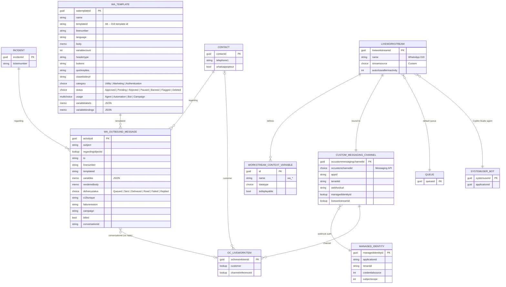
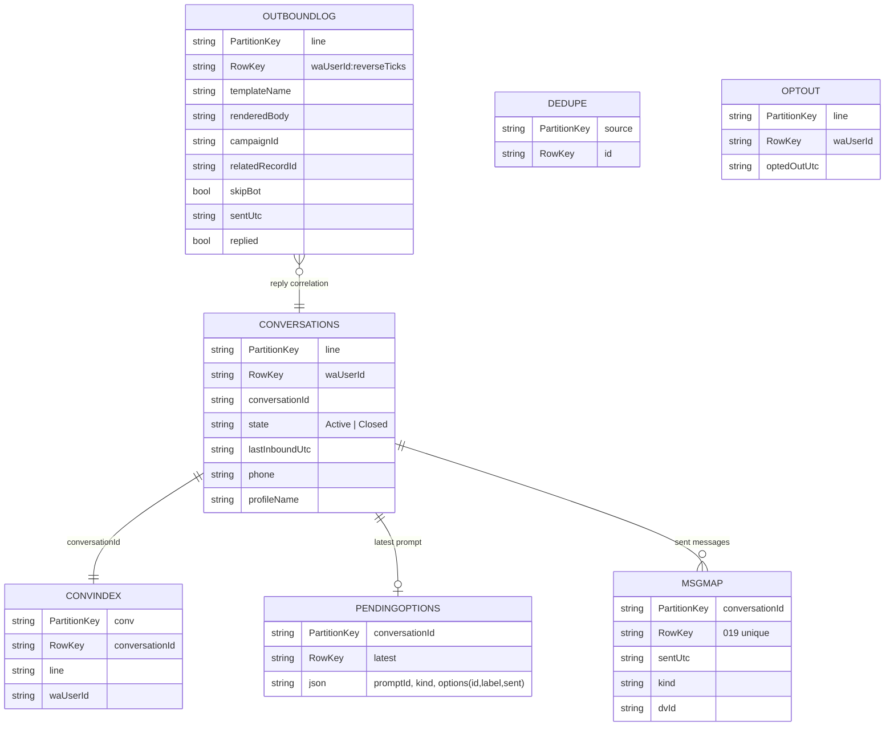

# Data model

The solution uses three data stores:

1. **Dataverse:** a custom solution with two tables, plus standard Contact Center tables.
2. **Contact Center configuration:** the channel, workstream, context variables and managed identity records.
3. **Adapter state:** Azure Table Storage holding operational keys only. It stores no message bodies.

## 1. Dataverse and Contact Center (ERD)

`WA_TEMPLATE`, `WA_OUTBOUND_MESSAGE` and the `whatsappoptout` column are delivered by the solution. The remaining entities are standard Dynamics 365 Contact Center tables.

## 2. Workstream context variables

| Name | Type | Shown to representative | Content |
|---|---|---|---|
| `wa_LineNumber` | Text | No | WhatsApp business line |
| `wa_UserId` | Text | No | WhatsApp user identifier (phone, or a WhatsApp-scoped id) |
| `wa_ProfileName` | Text | Yes | WhatsApp profile name |
| `wa_EntryPoint` | Text | Yes | `organic` · `outbound-reply` · `template-button` |
| `wa_TemplateName` | Text | Yes | Template that triggered the conversation |
| `wa_CampaignId` | Text | No | Outbound correlation |
| `wa_RelatedRecordId` | Text | No | Record that triggered the outbound message |
| `wa_Is24hWindowOpen` | Boolean | No | Informational |
| `wa_LastInteraction` | Text (JSON) | No | Full payload of the latest button or list selection (only when `WA_SELECTION_EVENT=true`) |

Copilot Studio receives each variable as a **global variable with the same name**, with *External sources can set values* enabled.

## 3. Adapter state (Azure Table Storage)

**Data minimization:** message bodies are never written to tables. They exist only transiently in Service Bus (TTL of 1 day) and in Dynamics 365.
