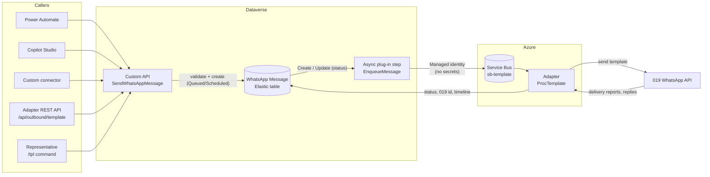
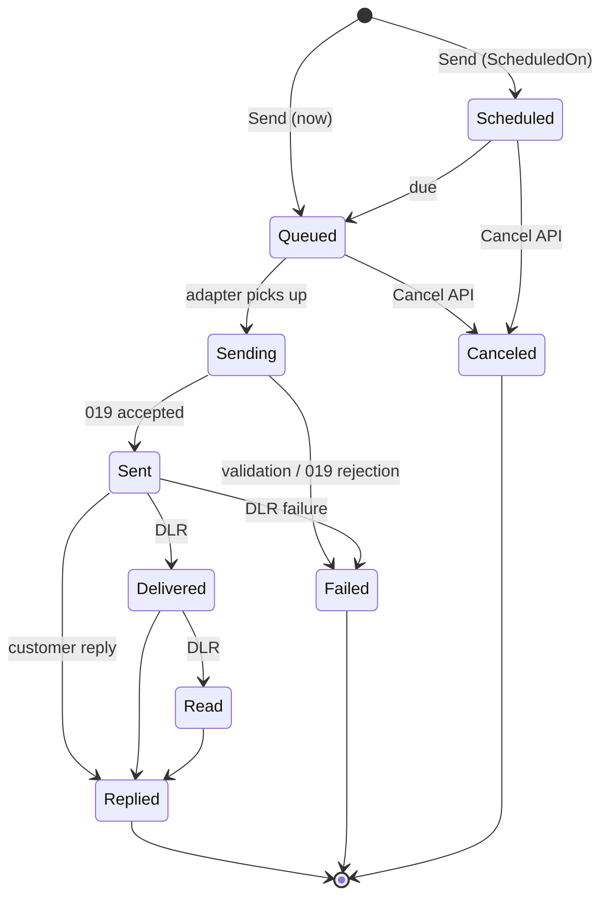

# Outbound messaging (proactive WhatsApp templates)

**Audience:** solution architects, Power Platform makers, developers and operators.

Every proactive WhatsApp message (a template sent outside an active conversation) is a **row in Dataverse** before it reaches WhatsApp. The row is the request, the queue item and the audit record in one place:

- **Create a row** (status *Queued* or *Scheduled*) → the platform delivers it.
- **Read the row** → current status: sent, delivered, read, replied, failed or canceled.
- **Update the row** → cancel or reschedule.

The same path serves Power Automate, Copilot Studio, custom connectors, the adapter REST API, the representative `/tpl` command and any system that can call Dataverse.

## Contents

1. [Architecture](#1-architecture)
2. [Message lifecycle](#2-message-lifecycle)
3. [The WhatsApp Message table](#3-the-whatsapp-message-table)
4. [Custom APIs](#4-custom-apis)
5. [How to send: choose an entry point](#5-how-to-send-choose-an-entry-point)
6. [Template buttons and reply correlation](#6-template-buttons-and-reply-correlation)
7. [Security](#7-security)
8. [Deployment](#8-deployment)
9. [Operations](#9-operations)
10. [Troubleshooting](#10-troubleshooting)

## 1. Architecture



| Step | Component | What happens |
|---|---|---|
| 1 | **Custom API** `<prefix>_SendWhatsAppMessage` | Validates the recipient, template (must exist and be *Approved*) and variables. Applies idempotency. Creates the row |
| 2 | **WhatsApp Message** row | Status *Queued* (send now) or *Scheduled* (send at `ScheduledOn`) |
| 3 | **Async plug-in step** on Create and on Update of status / scheduled time | Posts `{id, partitionId}` to the Service Bus queue using the **Power Platform managed identity** of the plug-in assembly. Scheduled rows become Service Bus *scheduled messages* |
| 4 | **Adapter** `ProcTemplate` | Re-reads the row (source of truth). Skips anything that is no longer *Queued/Scheduled* (for example, canceled). Checks opt-out, sends to 019, updates the row, optionally creates a timeline activity |
| 5 | **Delivery reports** | 019 reports update the row: *Delivered*, *Read*, *Failed* |
| 6 | **Customer reply** | The reply is matched to the exact message. The row becomes *Replied* and the new conversation receives the template context |

Why this design:

- **Dataverse is the system of record.** Every request is visible, queryable and secured by Dataverse security roles. Nothing is held only in a queue or a log store.
- **Asynchronous and resilient.** Callers get an immediate answer (`MessageId`, `Status`). Delivery uses Service Bus retries and dead-lettering.
- **No secrets in Dataverse.** The plug-in authenticates to Service Bus with a managed identity (federated credential). Dataverse service endpoints with SAS keys aren't used.
- **One validation path.** All entry points call the same Custom API.

## 2. Message lifecycle



| Status | Value | Set by | Meaning |
|---|---|---|---|
| Queued | `<optionPrefix>0000` | Custom API | Waiting to be sent now |
| Scheduled | `…0001` | Custom API | Waiting for `ScheduledOn` |
| Sending | `…0002` | Adapter | Being sent (attempt counter incremented) |
| Sent | `…0003` | Adapter | 019 accepted the message (`019 Message Id` set) |
| Delivered | `…0004` | Delivery report | Delivered to the handset |
| Read | `…0005` | Delivery report | Read by the customer |
| Replied | `…0006` | Adapter | Customer replied or tapped a button |
| Failed | `…0007` | Adapter / delivery report | See *Failure Code* and *Failure Reason* |
| Canceled | `…0008` | Cancel API | Canceled before sending |
| Expired | `…0009` | Reserved | Not set by the current version |

Status only moves forward (*Sent → Delivered → Read → Replied*). Late or duplicate delivery reports are ignored.

## 3. The WhatsApp Message table

`<prefix>_wamessage` – created by [`scripts/05-outbound-messages.ps1`](../scripts/05-outbound-messages.ps1).

### Elastic table

The table is a Dataverse **elastic table** (Azure Cosmos DB storage):

- **Scale:** high write throughput for campaigns without affecting relational tables.
- **Automatic retention:** every row gets `ttlinseconds` (default **365 days**, environment variable `<prefix>_WaRetentionDays`; `0` = keep). Dataverse deletes expired rows automatically.
- **Partitioning:** `partitionid` = recipient. Rows are addressed by the key `(<prefix>_wamessageid, partitionid)`.
- **Capacity:** elastic tables consume Dataverse **log** capacity.

> **Creating elastic tables by API.** Dataverse silently creates a *Standard* table if any capability that elastic tables don't support is left at its default. The script sends the same explicit `false` values as the maker portal (audit, duplicate detection, queues, SLA, offline, mail merge, connections, and so on) and verifies `TableType` afterwards. If you create the table manually, use **Power Apps → Solutions → your solution → New → Table → Table (advanced properties) → Advanced options → Type: Elastic**, then rerun the script to add the columns.
>
> The plug-in and adapter also work with a Standard table (detected at runtime). In that case, configure a **bulk-delete job** for rows older than the retention period.

### Columns

| Column | Type | Description |
|---|---|---|
| `<prefix>_name` | Text | `<template> → <recipient>` |
| `<prefix>_to` | Text | Recipient (E.164 digits or WhatsApp user ID) |
| `<prefix>_linenumber` | Text | Sending business line |
| `<prefix>_template` | Text | Template as requested (name or 019 id) |
| `<prefix>_templateid` / `<prefix>_templatename` | Text | Resolved template |
| `<prefix>_variables` | Multiline | Variables as JSON, e.g. `{"1":"Dana"}` |
| `<prefix>_renderedbody` | Multiline | Final text sent to the customer |
| `<prefix>_messagestatus` | Choice | See [lifecycle](#2-message-lifecycle) |
| `<prefix>_source` | Choice | API, Flow, Agent, Bot, Campaign |
| `<prefix>_scheduledon` / `<prefix>_senton` / `<prefix>_repliedon` | Date and time | Lifecycle timestamps |
| `<prefix>_campaignid` | Text | Campaign or batch correlation |
| `<prefix>_idempotencykey` | Text | Caller key; a repeated key returns the existing row |
| `<prefix>_correlationid` | Text | Free correlation for the caller |
| `<prefix>_relatedentity` / `<prefix>_relatedrecordid` | Text | Record the message relates to (any table) |
| `<prefix>_conversationid` | Text | Contact Center conversation that requested the send, or that the reply created |
| `<prefix>_o19unique` | Text | 019 message ID (used for delivery reports and reply correlation) |
| `<prefix>_attempts` | Whole number | Send attempts |
| `<prefix>_failurecode` / `<prefix>_failurereason` | Text | Failure details (English) |
| `<prefix>_replybutton` / `<prefix>_replybuttonindex` | Text / Whole number | Quick-reply button the customer tapped |
| `<prefix>_createtimelineactivity` | Yes/No | Also create a *WhatsApp Outbound* timeline activity |
| `<prefix>_activityid` | Text | The timeline activity, when created |
| `partitionid`, `ttlinseconds` | System | Elastic partition and time to live |

Related text columns are used instead of lookups so that the table can reference **any** record (elastic tables don't support all relationship types, and the solution must stay generic).

### Timeline (hybrid)

The table is the complete log. A **WhatsApp Outbound** activity on the timeline of the related record is created only when it adds value to people:

- always for representative sends (`/tpl`, source *Agent*);
- when the caller sets `CreateTimelineActivity = true`.

Bulk and automated sends stay out of the timeline unless requested.

## 4. Custom APIs

Both APIs are unbound Dataverse actions, usable from every Dataverse client.

### `<prefix>_SendWhatsAppMessage`

| Parameter | Type | Required | Description |
|---|---|---|---|
| `To` | String | Yes | E.164 number (digits, `+` optional) or WhatsApp user ID |
| `Template` | String | Yes | Template name or 019 template ID. Must be *Approved* |
| `Variables` | String | No | JSON object, e.g. `{"1":"Dana","2":"10:00"}`. Every `{{n}}` in the template is required |
| `Line` | String | No | Business line. Default: environment variable `<prefix>_WaDefaultLine` |
| `ScheduledOn` | DateTime | No | Send at this UTC time. Empty = now |
| `CampaignId` | String | No | Campaign or batch correlation |
| `IdempotencyKey` | String | No | Same key → same message (no second send) |
| `RelatedRecord` | EntityReference | No | Record the message relates to (any table) |
| `Source` | String | No | `API` (default), `Flow`, `Agent`, `Bot`, `Campaign` |
| `CreateTimelineActivity` | Boolean | No | Create a timeline activity after sending |
| `ConversationId` | String | No | Contact Center conversation to notify (sent / failed) |

| Output | Type | Description |
|---|---|---|
| `MessageId` | Guid | WhatsApp Message row ID |
| `Status` | String | `Queued`, `Scheduled`, or the existing status for a repeated idempotency key |

Validation errors are returned immediately (HTTP 400 from the Web API): unknown or unapproved template, missing variable, invalid recipient, no line.

Web API example:

```http
POST https://<org>.crm.dynamics.com/api/data/v9.2/<prefix>_SendWhatsAppMessage
Content-Type: application/json

{
  "To": "14255550100",
  "Template": "appointment_reminder",
  "Variables": "{\"1\":\"Dana\",\"2\":\"12/11 10:00\"}",
  "CampaignId": "APPOINTMENTS",
  "IdempotencyKey": "case-123-reminder-1",
  "RelatedRecord": { "@odata.type": "Microsoft.Dynamics.CRM.incident", "incidentid": "<guid>" },
  "CreateTimelineActivity": true
}
```

### `<prefix>_CancelWhatsAppMessage`

| Parameter | Type | Description |
|---|---|---|
| `MessageId` (in) | Guid | Row to cancel |
| `Status` (out) | String | `Canceled`, or the current status when it's too late to cancel |

Rescheduling: update `<prefix>_scheduledon` on a *Scheduled* row. The plug-in enqueues a new scheduled message; the earlier one is skipped when it arrives because the adapter always re-reads the row.

## 5. How to send: choose an entry point

| Entry point | Best for | Authentication | Notes |
|---|---|---|---|
| **Power Automate – Dataverse connector, *Perform an unbound action*** | Event-driven messages (case created, appointment reminder) | Flow connection (user or service principal) | **Recommended.** No extra components. Works in solutions and ALM |
| **Copilot Studio – Dataverse connector tool or agent flow** | Agent-initiated messages | Agent / maker connection | Same Custom API |
| **Custom connector** ([`connector/whatsapp-messaging.swagger.json`](../connector/whatsapp-messaging.swagger.json)) | A friendly, discoverable *WhatsApp* action for makers, or non-Dataverse-aware tools | OAuth 2.0 (Entra ID) to Dataverse | Optional wrapper over the same Custom APIs |
| **Dataverse Web API / SDK** | Line-of-business systems, Azure services | Entra app user | Call the Custom API directly |
| **Create the row directly** | Data integration (Dataflows, ADF, Synapse) | Any Dataverse writer | Fill `To`, `Template`, `Variables`, status *Queued*. No validation before the send; failures are recorded on the row |
| **Adapter REST** `POST /api/outbound/template` | Existing integrations of earlier versions | Entra JWT (adapter audience) | Returns **202** with `{messageId, status}`; calls the Custom API |
| **Representative** `/tpl <template> v1\|v2` | Sending a template from the conversation | Representative session | Always creates a timeline activity |

### Custom API or custom connector?

Use the **Custom API** as the contract. It's part of the solution, runs inside Dataverse security, is versioned with the solution and is available to every Dataverse client without extra components. Power Automate and Copilot Studio can call it through the standard Dataverse connector.

Add the **custom connector** only when makers need a dedicated *WhatsApp* connector in the designer, or when the caller can't use the Dataverse connector. The connector is a thin OpenAPI wrapper over the same Custom APIs, so it adds no logic and no extra security surface.

### Power Automate (recommended)

1. Add **Microsoft Dataverse → Perform an unbound action**.
2. Action name: **`<prefix>_SendWhatsAppMessage`**.
3. Fill **To**, **Template** and **Variables** (for example, `{"1":"@{triggerOutputs()?['body/firstname']}"}`).
4. Use the output **MessageId** to track the row, or add a **When a row is modified** trigger on *WhatsApp Message* filtered on *Message Status* to react to *Delivered*, *Read*, *Replied* or *Failed*.

The flow connection's user (or service principal) needs the **WhatsApp Message Sender** role.

### Custom connector

1. In Power Apps or Power Automate: **Custom connectors → New custom connector → Import an OpenAPI file** → [`connector/whatsapp-messaging.swagger.json`](../connector/whatsapp-messaging.swagger.json).
2. **General:** set *Host* to your organization host (`<org>.crm.dynamics.com`). Replace the `alex_` prefix in the paths with your publisher prefix.
3. **Security:** OAuth 2.0 → *Azure Active Directory*. Use an Entra app registration with the delegated **Dynamics CRM → user_impersonation** permission. *Resource URL* = `https://<org>.crm.dynamics.com`.
4. Add the connector to your solution. The connector doesn't expose `RelatedRecord` (an entity reference); use the Dataverse connector when you need it.

## 6. Template buttons and reply correlation

When a customer taps a quick-reply button on a template, 019 sends the button label and the ID of the original message (`quoteUnique`). The adapter matches this ID **exactly** to the WhatsApp Message row, so each tap is tied to the specific message that was sent, even when the same template was sent several times.

On a match:

- the row becomes **Replied** with *Reply Button* and *Reply Button Index*;
- the new conversation receives these context variables:

| Context variable | Value |
|---|---|
| `wa_EntryPoint` | `template-button` (tap) or `outbound-reply` (free-text reply) |
| `wa_TemplateName` | Template name |
| `wa_OutboundMessageId` | WhatsApp Message row ID |
| `wa_TemplateButton` | Button label |
| `wa_TemplateButtonIndex` | 1-based button position (stable even if labels are translated) |
| `wa_CampaignId`, `wa_RelatedEntity`, `wa_RelatedRecordId` | From the original request |

Use them in routing rules or in the Copilot Studio agent (global variables of the same names; see [Copilot Studio integration](copilot-studio.md)). For example, route `wa_TemplateButtonIndex = 2` (*Cancel*) to a dedicated queue, or let the agent continue the flow with `wa_RelatedRecordId`.

Free-text replies without a quoted message fall back to the most recent message sent to the same customer within `OUTBOUND_REPLY_WINDOW_HOURS` (default 72).

## 7. Security

| Principal | Role / permission | Why |
|---|---|---|
| Callers (users, flow connections, agents, integrations) | **WhatsApp Message Sender** (created by `04-security-role.ps1`) | Create and write own *WhatsApp Message* rows, read all rows and templates, read system jobs |
| Adapter application user | **WhatsApp 019 Adapter** | Read and update message rows, create timeline activities, call the Custom API on behalf of REST and `/tpl` |
| Plug-in assembly | **Power Platform managed identity** → Entra app with federated credentials → **Azure Service Bus Data Sender** on the queue only | Enqueue without secrets |

Notes:

- The Custom API's *execute privilege* is `prvCreate<prefix>_wamessage`. A caller who can't create message rows can't send.
- Callers need **`prvReadAsyncOperation`**. Status changes start an asynchronous step, and Dataverse checks that the caller can read the resulting system job.
- The adapter updates rows with `If-Match: *` (update-only). An update by alternate key without it is an *upsert*, which on elastic tables needs the *Assign* privilege.
- Message content (variables and rendered body) is stored in your Dataverse environment only, under your retention policy. The Service Bus message contains only the row ID and partition.
- **Plug-in signing.** Managed identity for plug-ins requires an Authenticode-signed assembly; the federated credential is bound to the certificate. Use your organization's code-signing certificate in production (`-CertificatePath`). `-DevCertificate` creates a self-signed certificate for development and test only.

## 8. Deployment

Prerequisites: steps 1–4 of the [deployment guide](deployment.md), .NET SDK 8 (builds the .NET Framework 4.6.2 plug-in), Azure CLI signed in with rights to create Entra apps and role assignments.

```powershell
cd scripts
./05-outbound-messages.ps1                       # elastic table and columns
./06-plugin-and-custom-api.ps1 -DevCertificate   # dev/test; production: -CertificatePath .\codesign.pfx -CertificatePassword (Read-Host -AsSecureString)
./04-security-role.ps1                           # adapter role + WhatsApp Message Sender role
./02-channel.ps1                                 # adds the template context variables to the workstream
./03-copilot-studio.ps1                          # adds the matching agent global variables
```

`06-plugin-and-custom-api.ps1`:

1. Environment variables `<prefix>_WaServiceBusNamespace`, `_WaQueueName`, `_WaDefaultLine`, `_WaRetentionDays`.
2. Builds the plug-in (`src/plugins`). A strong-name key is generated locally on first run and is never committed.
3. Signs the assembly (Authenticode) and registers it with the plug-in types.
4. Creates the Custom APIs and their parameters, and the async steps on Create and Update (`messagestatus`, `scheduledon`).
5. Creates the Entra app for the plug-in identity, its federated credentials, the Dataverse *managed identity* record, and the **Service Bus Data Sender** role on the queue.

The Service Bus queue `sb-template` is part of [`infra/main.bicep`](../infra/main.bicep) (no sessions, 14-day TTL, dead-letter queue).

## 9. Operations

| What | Where |
|---|---|
| Message status | *WhatsApp Message* table (views, Power BI through Synapse Link, flows on status change) |
| Plug-in execution | *Plug-in trace log* (`EnqueueMessage`, `SendMessageApi`) |
| Adapter processing | Application Insights: `MessageSent`, `MessageFailed`, `MessageSkipped`, `MessageNotDue` |
| Stuck messages | Service Bus `sb-template` dead-letter queue |

Retries:

- 019 rate limiting and transient errors → Service Bus redelivery (up to 5 attempts), then *Failed* with `SEND_ERROR`.
- Business rejections (opt-out, unknown or unapproved template, 019 reason codes) → *Failed* immediately with a failure code.

Requeue a message: set *Message Status* back to *Queued*. The update step enqueues it again.

| Failure code | Meaning |
|---|---|
| `OPTED_OUT` | The customer opted out of proactive messages |
| `TEMPLATE_NOT_FOUND`, `TEMPLATE_NOT_APPROVED` | Template changed after the request |
| `BAD_VARIABLES` | Variables aren't valid JSON (direct row creation) |
| `O19_<reason>` | 019 rejection |
| `DELIVERY` | Delivery report failure |
| `SEND_ERROR` | Retries exhausted |

## 10. Troubleshooting

| Symptom | Cause | Fix |
|---|---|---|
| Table created as *Standard* | An unsupported capability wasn't disabled in the create request | Delete the table and rerun `05-outbound-messages.ps1`, or create it in the maker portal (Type = Elastic) and rerun the script |
| Row stays *Queued*, plug-in trace shows *Enqueued* | Adapter can't update the row | Application Insights exceptions on `ProcTemplate`; check the adapter role |
| Adapter 403 *missing prvAssign…* | Update by alternate key without `If-Match` (upsert) | Use the current adapter version |
| Caller 403 *Read Privilege Check For Owner* | Caller lacks `prvReadAsyncOperation` | Assign **WhatsApp Message Sender** |
| Plug-in error *Service Bus enqueue failed: 401* | Managed identity not bound, or wrong certificate | Rerun `06-plugin-and-custom-api.ps1` with the same certificate used to sign the assembly |
| Plug-in error *environment variable … is not set* | Missing configuration | Rerun `06-plugin-and-custom-api.ps1` |
| Reply not correlated (`wa_EntryPoint = organic`) | Reply outside the window, or the customer replied without quoting | Expected for unrelated messages; template button taps are always exact |
