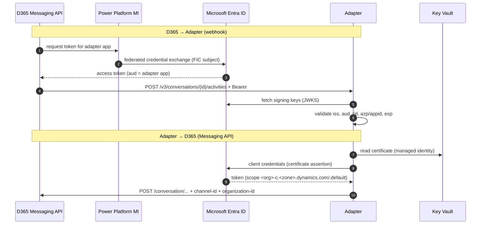

# Security

## 1. Identity model

| Identity | Type | Used for |
|---|---|---|
| **Adapter app registration** | Microsoft Entra single-tenant app, **certificate credential**, `requestedAccessTokenVersion = 2`, Application ID URI `api://<appId>` | (a) Adapter → Messaging API and Dataverse (client credentials). (b) Audience for D365 webhook tokens. (c) Audience for the outbound API |
| **Power Platform managed identity** | Dataverse `managedidentity` record + **federated identity credential** on the app | D365 → Adapter webhook. **No stored secret** |
| **Function App managed identity** | System-assigned | Key Vault, Storage and Service Bus (RBAC) |
| **Dataverse application user** | Bound to the adapter app, custom role *WhatsApp 019 Adapter* | Template catalog and outbound activity writes |
| **019 API token** | Bearer token held in Key Vault | Adapter → 019 |

## 2. Authentication flows

### Webhook token validation

Every call to `/api/d365/*` and `/api/outbound/*` is rejected unless all of the following hold:

- The signature is valid against Microsoft Entra signing keys.
- `tid` equals the configured tenant.
- `iss` is the tenant's v2.0 or v1 issuer.
- `aud` is the adapter Application ID URI or appId.
- For webhooks, `azp` / `appid` equals the adapter appId (the token was issued through the channel's federated credential).
- `exp` / `nbf` are within a 5-minute clock skew.

### 019 → Adapter

- The push URL contains a **random 256-bit route secret**, stored in Key Vault and compared in constant time.
- Pushes for **unknown WhatsApp lines** are rejected.
- Payloads are schema-validated and **de-duplicated** by 019 message id.
- Sensitive agent actions never rely on the WhatsApp identity alone. Copilot Studio topics apply their own verification (for example, an OTP).

## 3. Secrets

| Secret | Store | Rotation |
|---|---|---|
| 019 API token | Key Vault `wa019-o19-api-token` | Create a new 019 token, update Key Vault, delete the old token (up to 5 active tokens are supported) |
| Webhook route secret | Key Vault `wa019-webhook-path-secret` | Generate, update Key Vault, update the 019 push URLs |
| Adapter certificate | Key Vault `wa019-adapter-cert-pem` / `-sha256` | Issue a new certificate, add it to the app registration, update Key Vault, remove the old one |

The adapter reads secrets with its managed identity and caches them for 5 minutes. **No secret is stored in app settings, code or source control.**

## 4. Network

- **Key Vault and Storage:** public network access is disabled. They are reachable only through **private endpoints** from the integrated VNet.
- **Storage:** shared-key authorization and public blob access are disabled.
- **Service Bus:** local (SAS) authentication is disabled, so only Entra RBAC is accepted.
- **Function App:** HTTPS only, minimum TLS 1.2.
- **019:** TLS 1.2+ is enforced by the provider.

## 5. Data protection

| Data | Location | Retention |
|---|---|---|
| Conversation transcript | Dataverse | Contact Center retention policy |
| Message bodies in transit | Service Bus | 1-day TTL |
| Adapter state | Table Storage | IDs and routing keys only, **no message content** |
| Telemetry | Application Insights | Event names, types, ids and status codes. **No message text or phone numbers** |

Contact Center **data masking rules** apply to the channel, for example credit card, national ID and OTP patterns.

## 6. Threat model (STRIDE summary)

| Threat | Surface | Mitigation |
|---|---|---|
| **Spoofing** – forged D365 webhook | `/api/d365/*` | Entra JWT validation (issuer, audience, tenant, client) |
| **Spoofing** – forged 019 push | `/api/019/*` | Route secret, line allow-list, schema validation. Optional WAF IP filter |
| **Tampering** – replayed messages | All ingress | Idempotency store, Service Bus duplicate-safe processing |
| **Repudiation** | Outbound templates | Dataverse activity per send, with requester and delivery status |
| **Information disclosure** | Logs and storage | No message content in logs or tables. Private endpoints. RBAC |
| **Denial of service** | Public endpoints | Fast ACK + queue buffering, Flex scale-out. Optional WAF rate limiting |
| **Elevation of privilege** | Dataverse app user | Dedicated least-privilege role (template catalog + activity only) |

## 7. Compliance notes

- WhatsApp messages are processed by Meta and 019 as part of the WhatsApp Business Platform.
- Customer opt-out keywords are honored. Outbound sends to opted-out customers are blocked (HTTP 409).
